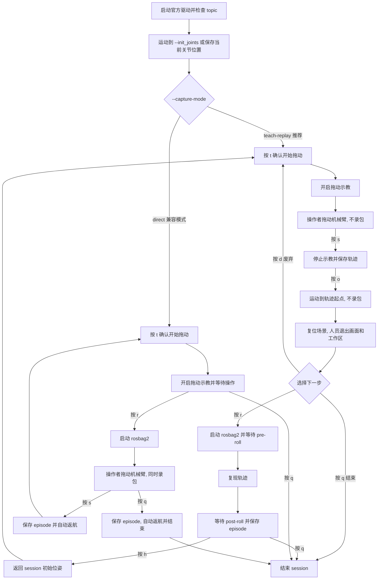

# 01 ROS 2、rosbag2 和 MCAP

## 1. 数据链路

| 格式 | 项目用途 | 是否保留完整 ROS topic |
|---|---|---|
| rosbag2 + MCAP storage | 默认原始采集格式 | 是 |
| rosbag2 + SQLite3 storage | 可选原始采集格式 | 是 |
| MCAP rosbag2 | SQLite3 bag 转换后的统一 storage | 是 |
| LeRobotDataset | 从单个 bag episode 派生的训练格式 | 否 |

一个 rosbag2 目录对应一个 episode。一次 `collect_data_ros2.py` 命令对应一个 session，并在 session 目录下创建多个独立 rosbag2 episode。

## 2. 环境配置

### 2.1 克隆仓库

```bash
export WORKSPACE=/home/zhangshenghong
cd "$WORKSPACE"

git clone --recurse-submodules https://github.com/IUNONE/xiazhi.git
cd "$WORKSPACE/xiazhi"
```

### 2.2 ROS 2 依赖安装

```bash
sudo apt update
sudo apt install \
  ros-humble-moveit \
  ros-humble-controller-interface \
  ros-humble-controller-manager-msgs \
  ros-humble-controller-manager \
  ros-humble-rosbag2-storage-mcap \
  python3-colcon-common-extensions \
  python3-rosdep \
  libgflags-dev \
  nlohmann-json3-dev \
  ros-humble-image-transport \
  ros-humble-image-transport-plugins \
  ros-humble-compressed-image-transport \
  ros-humble-image-publisher \
  ros-humble-camera-info-manager \
  ros-humble-diagnostic-updater \
  ros-humble-diagnostic-msgs \
  ros-humble-statistics-msgs \
  ros-humble-xacro \
  ros-humble-backward-ros \
  libdw-dev \
  libssl-dev \
  mesa-utils \
  libgl1 \
  libgoogle-glog-dev
```

ROS 2 采集不需要安装 RealMan Python SDK。机械臂控制全部通过 `rm_driver` 提供的 ROS 接口执行，避免 Python SDK 与驱动同时连接控制器。LeRobot 直采使用独立环境和 Python SDK，配置方式见 `00-data-collection-lerobot.md`。

### 2.3 编译 RealMan 和 Orbbec

#### 2.3.1 安装 RealMan 本地库

进入库目录，并根据当前 CPU 架构确定待安装的 RealMan C++ SDK 动态库：

```bash
cd "$WORKSPACE/xiazhi/third_party/ros2_rm_robot/rm_driver/lib"
uname -m

case "$(uname -m)" in
  x86_64)
    export REALMAN_LIB_SOURCE="$PWD/linux_x86_c++_v1.1.5/libapi_cpp.so"
    ;;
  aarch64)
    export REALMAN_LIB_SOURCE="$PWD/linux_arm64_c++_v1.1.5/libapi_cpp.so"
    ;;
  *)
    export REALMAN_LIB_SOURCE=""
    ;;
esac

if [[ -z "$REALMAN_LIB_SOURCE" ]]; then
  echo "当前 CPU 架构不受安装脚本支持: $(uname -m)"
elif [[ ! -f "$REALMAN_LIB_SOURCE" ]]; then
  echo "仓库中的待安装库不存在: $REALMAN_LIB_SOURCE"
elif [[ ! -f /usr/local/lib/libapi_cpp.so ]]; then
  echo "RealMan 本地库尚未安装"
elif cmp -s "$REALMAN_LIB_SOURCE" /usr/local/lib/libapi_cpp.so; then
  echo "RealMan 本地库已安装且与仓库版本一致"
else
  echo "RealMan 本地库已安装但与仓库版本不一致"
  sha256sum "$REALMAN_LIB_SOURCE" /usr/local/lib/libapi_cpp.so
fi
```

输出“已安装且与仓库版本一致”时跳过安装。输出“尚未安装”或“版本不一致”时，先检查脚本再安装：

```bash
sed -n '1,240p' lib_install.sh
sudo bash lib_install.sh
```

`lib_install.sh` 的写入和覆盖范围如下：

1. 删除已有的 `/usr/local/lib/libapi_cpp.so*` 文件或符号链接。
2. 根据 `uname -m`，将 `linux_x86_c++_v1.1.5/libapi_cpp.so` 或 `linux_arm64_c++_v1.1.5/libapi_cpp.so` 复制为 `/usr/local/lib/libapi_cpp.so`。
3. 使用同一架构的库覆盖仓库中的 `third_party/ros2_rm_robot/rm_driver/lib/libapi_cpp.so`。
4. 当 `/etc/ld.so.conf` 中不包含 `/usr/local/lib` 时，将该路径追加到文件中。
5. 运行 `/sbin/ldconfig` 更新系统动态库缓存。

安装后再次执行上面的检查命令，必须输出“已安装且与仓库版本一致”。

#### 2.3.2 查看并配置 RealMan 连接参数

按照 RealMan 官方有线连接流程访问 Web 示教器：

1. 将网线一端连接到机械臂控制器的有线网口，另一端连接到电脑的以太网口。
2. 启动机械臂并等待控制器完成初始化。
3. 将电脑有线网卡的 IPv4 地址设置到控制器所在网段。控制器使用出厂默认 IP `192.168.1.18` 时，可将电脑设置为 `192.168.1.100`，子网掩码设置为 `255.255.255.0`。电脑地址不允许与控制器地址相同。
4. 打开浏览器，推荐使用 Chrome，在地址栏输入 `http://192.168.1.18`。若控制器 IP 已修改，将地址替换为修改后的实际 IP。
5. 登录后进入 IP 模式设置页面，查看页面回显的控制器 IP：

- 第三代控制器：`配置 > 系统配置 > 通讯设置 > IP 模式设置`。
- 第四代控制器：`配置 > 基础配置 > IP 模式设置`。

参考 [RealMan 官方硬件准备](https://develop.realman-robotics.com/robot4th/quickUseManual/)、[第三代控制器配置](https://develop.realman-robotics.com/robot/teachingPendant/setting/) 和 [第四代控制器配置](https://develop.realman-robotics.com/robot4th/teachingPendantfour/setting/)。

记录当前机械臂的实际连接参数。下面的 IP 仅为出厂默认值，必须按 Web 示教器回显值修改：

```bash
export ROBOT_IP=192.168.1.18
export ROBOT_PORT=8080
```

查看 RealMan 驱动源码中当前写入的值：

```bash
export ROBOT_CONFIG="$WORKSPACE/xiazhi/third_party/ros2_rm_robot/rm_driver/config/rm_eco63_config.yaml"
sed -n -E '/^[[:space:]]*(arm_ip|tcp_port):/p' "$ROBOT_CONFIG"
```

在第一次编译前编辑该文件：

```bash
vim "$ROBOT_CONFIG"
```

确保配置值与 `ROBOT_IP` 和 `ROBOT_PORT` 一致：

```yaml
arm_ip: "192.168.1.18"
tcp_port: 8080
```

保存后再次运行查看命令确认。后续采集命令的 `--robot-ip` 和 `--robot-port` 必须使用同一组值。

#### 2.3.3 编译 ros package

```bash
conda deactivate

# 应输出 `/usr/bin/python3`，版本应为 Python 3.10
command -v python3
python3 --version
```

```bash
source /opt/ros/humble/setup.zsh
cd "$WORKSPACE/xiazhi"

if [ ! -f /etc/ros/rosdep/sources.list.d/20-default.list ]; then
  sudo rosdep init
fi
rosdep update --rosdistro humble

rosdep install \
  --from-paths third_party/ros2_rm_robot third_party/OrbbecSDK_ROS2 \
  --ignore-src -r -y --rosdistro humble \
  -t build -t buildtool -t build_export
```

```
colcon build \
  --base-paths third_party/ros2_rm_robot third_party/OrbbecSDK_ROS2 \
  --packages-select rm_ros_interfaces \
  --cmake-clean-cache \
  --cmake-args -DCMAKE_BUILD_TYPE=Release
source install/setup.zsh

colcon build \
  --base-paths third_party/ros2_rm_robot third_party/OrbbecSDK_ROS2 \
  --event-handlers console_direct+ \
  --cmake-clean-cache \
  --cmake-args -DCMAKE_BUILD_TYPE=Release

source install/setup.zsh
ros2 interface show rm_ros_interfaces/srv/StartMultiDragTeach
```

最后一条命令必须显示 `mode`、`singular_wall` 和 `status` 字段。项目为官方 `rm_driver` 补充了拖动、轨迹保存和回放 service，因此更新代码后必须重新编译 `rm_ros_interfaces` 和 `rm_driver`，不能继续使用旧的 `install/` 结果。

#### 2.3.4 安装 Orbbec udev 规则

```bash
cd "$WORKSPACE/xiazhi/third_party/OrbbecSDK_ROS2/orbbec_camera/scripts"
sudo bash install_udev_rules.sh
sudo udevadm control --reload-rules
sudo udevadm trigger
```

重新插拔相机并检查设备：

```bash
source /opt/ros/humble/setup.zsh
source "$WORKSPACE/xiazhi/install/setup.zsh"
ros2 run orbbec_camera list_devices_node
```

### 2.4 运行前检查

1. 操作者可立即触及急停，返航路径没有人员和障碍物。
2. ECO63 控制器无报错，机械臂固定可靠。
3. `rm_eco63_config.yaml` 中的 `arm_ip` 和 `tcp_port` 与采集命令一致。
4. 至少一台 Gemini 335 的 serial number 已确认。所有 serial number 必须唯一，命令行顺序必须固定。
5. `ros2 pkg prefix rm_driver`、`ros2 pkg prefix rm_description` 和 `ros2 pkg prefix orbbec_camera` 均成功。
6. 输出 session 目录不存在。
7. `ros2 interface show rm_ros_interfaces/srv/StartMultiDragTeach` 能显示新接口。采集程序只复用 `rm_driver` 的一个 SDK 连接，不再启动第二个 Python SDK 客户端。

## 3. rosbag2/MCAP 采集

### 3.1 输出结构

```text
<output-root>/<task>/<scene>/<session-id>/
├── session_manifest.json
├── trajectories/
│   ├── attempt_000000.txt   # 控制器拖动示教轨迹
│   └── attempt_000001.txt   # 废弃轨迹也保留并记录状态
├── episode_000000/          # 独立 rosbag2 目录
├── episode_000001/
└── ...
```

一个成功或中止的 replay 录包对应一个 episode。示教 attempt 不等于 episode，按 `d` 废弃的示教不会占用 episode 编号。session manifest 记录 capture mode、pre/post-roll、示教点数、轨迹路径、关联 episode 和回放结果。

目录存在时立即报错。示教、返轨迹起点、场景复位和返航都不会进入 bag。

### 3.2 采集命令

将 `ROBOT_IP` 和 `ROBOT_PORT` 设置为 2.3.2 中确认的实际值，不要直接沿用示例值。

```bash
conda deactivate

export WORKSPACE=/home/zhangshenghong
export ROBOT_IP=192.168.1.18
export ROBOT_PORT=8080
export SN_1=CP0N763000HE
export SN_2=CP0N7630000A
source /opt/ros/humble/setup.zsh
source "$WORKSPACE/xiazhi/install/setup.zsh"
cd "$WORKSPACE/xiazhi"
export PYTHONPATH="$PWD${PYTHONPATH:+:$PYTHONPATH}"

python3 scripts/collect_data_ros2.py \
  --output-root /home/zhangshenghong/Downloads \
  --task 'clean toilet' \
  --scene yuanzhi28 \
  --session-id session_000001 \
  --robot-ip "$ROBOT_IP" \
  --robot-port "$ROBOT_PORT" \
  --init_joints='[0,60,-135,75,90,0]' \
  --drag-mode 3 \
  --force-drag-mode precise \
  --capture-mode teach-replay \
  --replay-pre-roll-s 1.0 \
  --replay-post-roll-s 0.5 \
  --camera-serial "$SN_1" \
  --camera-serial "$SN_2" \
  --storage-id mcap
```

采集程序只启动机械臂最小组合：`rm_driver` 和 `robot_state_publisher`。不会启动 `rm_control`、`move_group` 或 RViz。拖动示教、轨迹保存、轨迹起点运动和轨迹复现均通过 `rm_driver` 新增的 ROS service 执行，并复用驱动内部唯一的 RealMan SDK handle。因此不再需要 `--allow-sdk-driver-coexistence`。

提供 `--init_joints='[0,60,-135,75,90,0]'` 时，程序在 topic 和控制连接检查通过后，以 `--home-return-speed` 指定的速度运动到该六关节角度，再开始拖动示教。参数单位为 degree，必须包含 6 个有限数值。zsh 中必须为方括号值添加引号。后续 episode 返航也返回该位姿。未提供参数时继续使用连接时的当前关节位姿。

启动后可在另一个终端确认进程组成：

```bash
ps -ef | rg 'rm_driver|robot_state_publisher|rm_control|move_group|rviz2'
```

正常结果应包含 `rm_driver` 和 `robot_state_publisher`，不应包含本次采集启动的 `rm_control`、`move_group` 或 `rviz2`。如果此前手动启动过其他 RealMan 节点，应先正常结束旧进程，确保只有当前 `rm_driver` 连接机械臂。

`--force-drag-mode` 仅在 `--drag-mode 1`、`2`、`3` 的末端六维力拖动中生效：

- `fast`：快速拖动，手感较轻且响应灵敏，程序默认值。
- `precise`：精准拖动，手感较沉，较容易控制细微运动。本文采集命令使用该模式。

取值含义来自 [RealMan 官方六维力拖动模式说明](https://develop.realman-robotics.com/robot/apipython/classes/dragTeach/)。

---

`--capture-mode` 有两种取值：

- `teach-replay`：推荐。先记录控制器拖动轨迹，人员退出后由机械臂复现，此时才录制 rosbag2。
- `direct`：兼容原有流程，人员拖动机械臂时直接录制 rosbag2，默认值。

当前 `teach-replay` 只记录并复现机械臂关节轨迹，不包含夹爪开合动作。

---

`--replay-pre-roll-s` 和 `--replay-post-roll-s` 仅用于 `teach-replay`，分别表示轨迹复现前后继续录包的时间，默认值为 `1.0` 秒和 `0.5` 秒。

默认录制：

- `/joint_states`、末端位姿、原始/零点六维力、错误状态和 TF；
- 命令行指定的所有相机的 RGB、depth 和 camera info；
- MCAP rosbag2 storage。使用 `--storage-id sqlite3` 可改为 DB3；
- 使用 `--extra-topic /some/topic` 可重复添加其他 topic。

---

交互按键：

- 每次拖动开始前按 `t`：确认操作者已准备完成，程序随后开启拖动示教。按下前机械臂不处于拖动示教状态。
- 示教中按 `s`：结束示教并保存控制器轨迹，不会创建 rosbag2 episode。
- 保存轨迹后按 `o`：确认操作者已离开机械臂工作区，允许机械臂主动运动到轨迹起点。
- 到达起点后按 `r`：确认场景已复位、人员已离开摄像头和工作区，开始回放录包。
- 到达起点后按 `d`：废弃本次示教，不创建 episode，保留轨迹文件和 manifest 记录用于追溯。
- 回放中按 `s`：停止回放，当前 rosbag2 保留但 episode 标记为 `failed`。
- episode 结束后按 `h`：确认返航路径安全后返回 session 初始位姿。
- 任意等待阶段按 `q` 或 `Ctrl-C`：结束会话。`teach-replay` 不会在异常清理中自动移动机械臂。





## 4. 数据格式转换

### 4.1 SQLite3 rosbag2 转 MCAP

使用 SQLite3 storage 时执行：

```bash
python3 scripts/convert_rosbag2_to_mcap.py \
  --input-bag /data/raw/pick/table_a/session_000001/episode_000000 \
  --output-bag /data/processed/pick/table_a/session_000001/episode_000000_mcap
```

输入、输出必须是不同目录，输出目录必须不存在。

### 4.2 MCAP/rosbag2 转 LeRobotDataset

输入必须是包含 `metadata.yaml` 的 rosbag2 episode 目录，storage 可以是 `mcap` 或 `sqlite3`。

至少一路 RGB 必须显式映射，depth 可选。`--image-topic` 和 `--depth-topic` 应按实际录制的相机数量重复提供：

```bash
python scripts/convert_rosbag2_to_lerobot.py \
  --input-bag /data/raw/pick/table_a/session_000001/episode_000000 \
  --output-root /data/lerobot/pick/table_a/session_000001_episode_000000 \
  --repo-id local/xiazhi_pick \
  --task 'pick the object' \
  --fps 30 \
  --image-topic camera_01=/camera_01/color/image_raw \
  --image-topic camera_02=/camera_02/color/image_raw \
  --depth-topic camera_01_depth=/camera_01/depth/image_raw \
  --depth-topic camera_02_depth=/camera_02/depth/image_raw
```

默认数值来源：

- state：`/joint_states.position`；
- EE pose：`/rm_driver/udp_arm_position`；
- force：`/rm_driver/udp_six_zero_force`。

转换过程：

1. 以 joint state 为基准按 `--fps` 降采样。
2. 在 `--tolerance-s` 内选择最近的 EE pose、force、RGB 和 depth。
3. 相邻 observation 生成 `action(t)=q(t+1)`，每个 bag 独立成为一个 episode。
4. 丢弃缺少必需传感器的帧和最后一个 observation。
5. 使用当前 `LeRobotDataset.create/add_frame/save_episode/finalize` 写入。

可使用 `--state-topic`、`--state-field`、`--ee-pose-topic` 和 `--force-topic` 修改默认映射。

## 5. Rerun 可视化与验收


```bash
conda create -n rerun python=3.12 pip -y
conda activate rerun
python -m pip install 'rerun-sdk>=0.28,<0.34'
```


```bash
conda activate rerun
export PYTHONPATH="$PWD${PYTHONPATH:+:$PYTHONPATH}"

python scripts/visualize_rerun.py \
  "/home/zhangshenghong/Downloads/clean toilet/yuanzhi28/session_000001/episode_000000"
```

脚本会在 Viewer 使用期间保持数据流连接，关闭 Rerun 窗口后自动结束。

其余两个 episode 分别执行：

```bash
python scripts/visualize_rerun.py \
  "/home/zhangshenghong/Downloads/clean toilet/yuanzhi28/session_000002/episode_000000"

python scripts/visualize_rerun.py \
  "/home/zhangshenghong/Downloads/clean toilet/yuanzhi28/session_000002/episode_000001"
```

入口默认生成以下布局：

- 左侧为深色背景的 ECO63 三维视图。
- 右上按相机排列 RGB 和 depth。
- 右下显示 `/joint_states` 六关节曲线。
- 底部展开统一时间轴，Blueprint 和 Selection 面板默认折叠。

如果单独复制了 `.mcap` 文件而没有同目录的 `metadata.yaml`，可重复传入相机名称：

```bash
python scripts/visualize_rerun.py /data/episode_000000.mcap \
  --camera-name camera_01 \
  --camera-name camera_02
```

不需要机械臂模型时添加 `--no-robot-model`。保存原始 MCAP importer 的 RRD 结果而不打开窗口：

```bash
python scripts/visualize_rerun.py \
  "/home/zhangshenghong/Downloads/clean toilet/yuanzhi28/session_000001/episode_000000" \
  --output-rrd /home/zhangshenghong/Downloads/review/session_000001_episode_000000.rrd
```

该导出命令等价于调用官方 `rerun mcap convert`，保存的是 MCAP 解码结果。自定义窗口布局和额外加载的 ECO63 URDF 用于交互式查看，不写入这个 RRD。

### 5.3 相机视锥与外参边界

`CameraInfo` 会生成 Rerun Pinhole，因此 Rerun 支持在三维视图中显示相机视锥，也支持让二维图像与三维坐标系联动。参考 [Rerun Transforms 与 Pinhole](https://rerun.io/docs/concepts/logging-and-ingestion/transforms)。

当前三个 bag 中，机械臂 TF 树与每台相机的 TF 树互不连接：

```text
base_root -> base_link -> Link1 -> ... -> Link6

camera_01_link -> camera_01_depth_frame -> camera_01_color_frame/optical_frame
camera_02_link -> camera_02_depth_frame -> camera_02_color_frame/optical_frame
```

因此当前可以正确显示机械臂动画和各路相机画面，但不能正确地把相机视锥放进机械臂三维坐标系。不要人为填写一个看起来合理的外参：

- 固定在工作区的相机需要标定并记录 `base_root -> camera_N_link` 静态 TF，视锥应固定不动。
- 安装在机械臂末端的相机需要标定并记录 `Link6 -> camera_N_link` 静态 TF，视锥会随 `Link6` 运动。

外参应在后续采集前通过 `/tf_static` 写入 rosbag2。完成外参标定后，无需改动 Rerun 布局，MCAP importer 会自动连接命名坐标系并显示相机视锥。

### 5.4 每个 episode 的验收项

1. `session_manifest.json` 中 session 和目标 episode 的 `status` 都是 `completed`，相机 serial 与现场设备一致。
2. 各路 RGB 连续，没有黑帧、冻结或相机名称交换。
3. 各路 depth 单位为 mm，分辨率正确，没有异常整帧空值。
4. 六关节曲线连续且不超关节极限，机械臂模型运动方向与实际回放一致。
5. 末端位姿和六维力随动作连续变化，没有明显时间错位。
6. replay 前后的 pre-roll 和 post-roll 静止段符合命令行设置，操作者没有进入录制画面。
7. 返轨迹起点、场景复位和返航没有进入 episode。
8. 不存在异常时间跳变、相机帧长时间冻结或机械臂 TF 中断。
